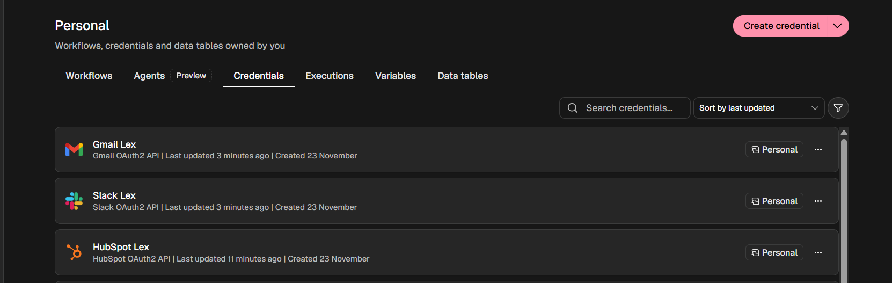

# Asistente de Expedientes — Pre-Entrega 4 (Módulo 4)

AI Automation Avanzado · CoderHouse · Comisión 97500

Integraciones del sistema multi-agente con un **CRM** (HubSpot), una **casilla de correo** (Gmail) y el **canal del equipo** (Slack). El Manager de la Pre-Entrega 3 (Router + Workers + memoria en Airtable) deja de recibir consultas por chat y pasa a recibirlas **por correo**: cada mail se filtra, se limpia, se registra en el CRM, se responde con un **borrador** que revisa una persona y se avisa al equipo por Slack.

**Todos los datos son ficticios.** Ningún expediente, carátula, contacto ni persona es real.

## Archivo entregado

`checkpoint4_estanislao_ortiz.json` — workflow **Manager Email (M4)** exportado de n8n Cloud (*Workflow → Download*). Los correos de destino de los avisos internos se reemplazaron por direcciones de ejemplo.

## Credenciales: las 3 conexiones OAuth2 activas



| Servicio | Credencial | Tipo | Lectura | Escritura |
|---|---|---|---|---|
| Casilla de correo | `Gmail Lex` | Gmail OAuth2 API | Gmail Trigger (mensajes no leídos de la bandeja de entrada) | Create Draft (nunca envía) |
| CRM | `HubSpot Lex` | HubSpot OAuth2 API | Search de contactos por email | Create or Update de contactos |
| Canal del equipo | `Slack Lex` | Slack OAuth2 API | — | Mensaje en `#all-asistente-expedientes` |

## Arquitectura

```
Gmail Trigger ─► ① ¿Auto-reply? ──true──► (fin: no se responde a robots)
                        │false
                        ▼
                 ④ Limpieza ─► ¿Email válido? ──false──► (fin)
                                      │true
                                      ▼
                 ② Buscar contacto ─► ¿Contacto existe? ─true─► Actualizar contacto ─┐
                    (HubSpot Search)          └──────false────► Crear contacto ──────┤
                                                                                     ▼
   Entrada ─► Memoria (Airtable) ─► Router (gpt-4o-mini) ─► Workers 1/2 o respuesta fija
                                                                       │
                                                                       ▼
                                                               Respuesta lista
                                                        ┌──────────────┴──────────────┐
                                                        ▼                             ▼
                                         ③ Crear borrador (Gmail Draft)    Payload Slack ─► Aviso a Slack
       (en paralelo, como en M3: Log de observabilidad, Aviso al supervisor, Guardar turno y resumen de memoria)
```

## Los 4 nodos de control

| # | Nodo | Qué hace | Error que evita |
|---|---|---|---|
| ① | **¿Auto-reply?** (IF, modo **OR**, *Ignore Case*), inmediatamente después del trigger | Corta si el asunto contiene `Auto-reply`, `Out of office` o `Undeliverable`; si el remitente contiene `no-reply@`, `noreply@` o `mailer-daemon@`; o si el asunto contiene `[Asistente de Expedientes]` (los mails que genera el propio sistema) | Bucle infinito de respuestas automáticas |
| ② | **Buscar contacto** (HubSpot Search por email, *Always Output Data*) → **¿Contacto existe?** | Si existe → **Actualizar contacto** (Lead Status = En curso); si no → **Crear contacto** (Lifecycle = Lead, Lead Status = Nuevo) | Error 409 (contacto duplicado) |
| ③ | **Crear borrador** (Gmail → Draft) | Única salida de correo: el borrador queda en el mismo hilo, dirigido al remitente, sin Markdown, y una persona decide si lo envía | Envíos sin revisión humana (*human-in-the-loop*) |
| ④ | **Limpieza** (Set) + **¿Email válido?** (IF) | Deja solo `From` (dirección sola, en minúsculas), `Subject` y `BodyText` (sin el mail citado, máx. 4000 caracteres). Valida con una expresión regular que el email no esté vacío ni mal formado | Error 400 y payload pesado |

**Nota sobre ②:** el nodo HubSpot de n8n no tiene una operación "Update" separada para contactos; la única escritura es *Create or Update*. Por eso el Look up va primero y cada rama hace una sola cosa: la rama *true* solo actualiza un contacto que ya existe y la rama *false* solo crea uno nuevo. El flujo nunca intenta crear un contacto que ya está.

## Resto de la consigna

| Requisito | Cómo se cumple |
|---|---|
| Parte del workflow del Módulo 3 | Mismo pipeline de M3: memoria por sesión en Airtable, Router con salida estructurada, Workers como sub-workflows, Log y Aviso al supervisor. Ahora `Session_ID` = **email del remitente**, así que la memoria es por persona |
| Set antes de Slack | **Payload Slack** deja 6 campos (remitente, asunto, contacto nuevo/existente, ruta, estado y un extracto de 300 caracteres) |
| Lectura y escritura | Gmail: lee (Trigger) y escribe (Draft). HubSpot: lee (Search) y escribe (Create or Update). Slack: escribe |
| Test de regresión | 6 pruebas con la respuesta esperada escrita antes de correrlas (ver abajo) |

## Mínimo privilegio (scopes)

Las tres credenciales usan **Managed OAuth2** de n8n Cloud, que pide un paquete fijo de permisos por servicio. No se pueden elegir uno por uno desde n8n. Lo que el flujo usa de verdad:

| Servicio | Permisos que pide el paquete | Lo que usa el flujo |
|---|---|---|
| Gmail | Acceso completo a la casilla, modificar, redactar, etiquetas, complementos | Leer mensajes y crear borradores. No hay ningún nodo *Send* ni *Delete* hacia el remitente |
| HubSpot | Contactos, empresas, negocios, listas, formularios, tickets, owners (13 permisos) | Ver contactos y crear o modificar contactos. No usa empresas, negocios, listas, formularios ni tickets |
| Slack | Paquete estándar de la app de n8n | Publicar un mensaje en un canal |

Mitigaciones:
- Cuentas **dedicadas al proyecto**, con datos ficticios.
- El flujo usa solo las operaciones mínimas de cada servicio.
- *Allowed HTTP Request Domains* restringido en cada credencial, para que no se puedan usar desde un nodo HTTP Request genérico contra otros sitios.

En producción, el siguiente paso sería una app OAuth propia por servicio, con los scopes reducidos a `gmail.readonly` + `gmail.compose`, `crm.objects.contacts.read` + `crm.objects.contacts.write` y `chat:write`.

## Validación realizada

| Prueba | Caso | Resultado |
|---|---|---|
| P1 | Regresión del pipeline M3 con la entrada nueva | ✅ |
| P2 | Mail automático real (alerta de seguridad de `no-reply@accounts.google.com`) | ✅ tras corregir el operador del IF: *is equal to* → *contains* |
| P3 | Remitente que ya está en HubSpot | ✅ Look up encuentra el contacto → Actualizar, sin duplicado |
| P4 | Remitente nuevo | ✅ tras corregir una conexión: Crear contacto, y el Router lo deriva a Vencimientos |
| P5 | Punta a punta: borrador + Slack | ✅ borrador en el mismo hilo, saludo con el nombre, sin Markdown; aviso en Slack |
| P6 | Consulta de estrategia jurídica → Escalar | ✅ sin Worker; borrador de derivación; Aviso al supervisor y Log archivados en sus etiquetas |

Durante las pruebas apareció un riesgo de bucle que la consigna no mencionaba: un Log del propio sistema llegó a la casilla y se procesó como consulta. Se resolvió con la 7.ª condición del IF (asunto contiene `[Asistente de Expedientes]`).

## Cómo probarlo

1. Importar el `.json` en n8n (**Create Workflow → ⋯ → Import from File**).
2. Crear y elegir las credenciales propias: Gmail, HubSpot y Slack (OAuth2), OpenAI y Airtable.
3. Elegir los Workers de la Pre-Entrega 3 en *Llamar Worker 1* y *Llamar Worker 2*, y la base de Airtable de memoria en los nodos de Airtable.
4. Elegir el canal en *Aviso a Slack* y poner correos propios en *Log de observabilidad* y *Aviso al supervisor*.
5. Mandar un mail a la casilla conectada, por ejemplo `¿En qué estado está el expediente de Gutiérrez?`, y ejecutar el workflow. El resultado es un borrador en *Borradores*, el contacto en HubSpot y el aviso en Slack.

## Entregas anteriores

- Pre-Entrega 1: [`../checkpoint1_estanislao_ortiz.json`](../checkpoint1_estanislao_ortiz.json) · [README](../README.md)
